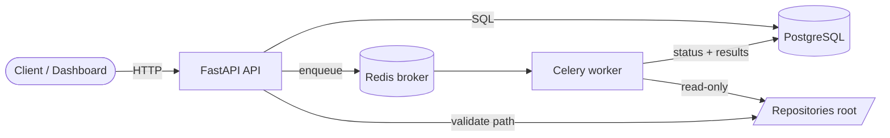

# TestMind — AI-Powered Software Testing Platform

[](https://github.com/AAli-gh/AI-Powered-Software-Testing-Platform/actions/workflows/ci.yml)


TestMind is a platform that takes a software repository, understands its structure and code,
generates and validates tests, runs them in isolation, measures coverage and mutation score,
explains failures and regressions, and produces a quality report.

It is **an intelligence layer on top of standard testing tools** (pytest, coverage.py, git,
Playwright), not a replacement for them. Deterministic tools do everything they can do reliably;
LLMs are used only where they add real value: writing tests, hypothesising root causes, and
summarising findings. Every AI output comes with its evidence and a confidence level.

> **Status: Phase 1 of 14 is complete: the platform foundation.**
> Repository analysis, test generation and the rest of the pipeline are **not implemented yet**.
> The [roadmap](#roadmap) shows exactly what exists today and what is planned.

---

## Contents

- [Problem](#problem) · [Solution](#solution) · [Architecture](#architecture)
- [What works today](#what-works-today) · [Tech stack](#tech-stack)
- [Quick start](#quick-start-docker) · [Configuration](#configuration) · [Usage](#usage)
- [API](#api) · [Development & testing](#development--testing) · [CI/CD](#cicd)
- [Security](#security) · [Roadmap](#roadmap) · [Documentation](#documentation)

## Problem

Writing good tests is slow, and it is hard to tell whether a test suite actually protects you.
High line coverage can hide tests that assert nothing. When CI goes red, engineers spend time
reading stack traces to work out which change broke what. Most "AI testing" tools generate code
without running it, never validate it, and state guesses as facts.

## Solution

A pipeline in which every stage is either deterministic or checked by a deterministic stage:

```text
Repository → Repository Analyzer → Code Analyzer (AST, static analysis)
           → AI Test Generator → Validation loop (syntax → run → analyse → fix, bounded)
           → Test Runner (pytest, sandboxed) → Coverage Analyzer (coverage.py)
           → Failure Analyzer (AI, evidence-based) → Regression Analyzer (git diff, test selection)
           → Mutation Testing → AI Report Generator → Dashboard / GitHub integration
```

## Architecture



The backend follows a layered (clean) architecture. Dependencies point only downwards, and the API
and worker share the same service layer:

```text
api/routes  →  services  →  repositories  →  db/models
workers/    ↗      ↘  domain (pure: enums, run state machine)
```

Details: [docs/architecture.md](docs/architecture.md). Design decisions are recorded as
[ADRs](docs/adr/).

## What works today

Phase 1 is the foundation that every later phase plugs into. All of it is implemented and tested:

- **Projects API**: register a local repository and list, get or delete projects. Paths are
  resolved and confined to a configured root, so `../`, absolute paths and symlinks that
  escape the root are rejected.
- **Analysis runs**: queued through **Celery + Redis** and executed by a separate worker. They
  follow an explicit state machine (`queued → running → succeeded | failed`, `queued → cancelled`)
  enforced with row locks, and the worker is idempotent under at-least-once delivery.
  *In Phase 1 a run only re-validates the project's source; the analysis itself is added in Phase 2.*
- **Operations**: liveness (`/health`) and readiness (`/ready`, real DB + Redis checks) probes,
  structured JSON logs with request-ID correlation, uniform error responses and OpenAPI docs.
- **Infrastructure**: PostgreSQL schema managed by Alembic (with a test that fails on
  model/migration drift), Docker images (non-root, read-only filesystem, all capabilities
  dropped), docker-compose for the full stack, and a GitHub Actions pipeline.
- **Test suite**: 167 tests, **100 % line and branch coverage**, against real PostgreSQL and
  Redis (no database mocks), plus an end-to-end smoke test of the running containers.

## Tech stack

| Area | Technology |
|---|---|
| Language | Python 3.11+ (images use 3.12) |
| API | FastAPI, Pydantic v2 |
| Persistence | PostgreSQL 16, SQLAlchemy 2 (async, asyncpg), Alembic |
| Background jobs | Celery, Redis |
| Observability | structlog (JSON), request IDs, health/readiness probes |
| Quality | pytest, pytest-asyncio, coverage.py, ruff, mypy (strict) |
| Security | bandit, pip-audit, gitleaks, non-root read-only containers |
| Packaging / infra | uv, Docker (multi-stage), docker compose, GitHub Actions |
| Planned | coverage.py & mutation testing engines, LLM providers (pluggable), Playwright, GitHub API, React dashboard |

## Quick start (Docker)

Requirements: Docker with Compose v2.

```bash
git clone https://github.com/AAli-gh/AI-Powered-Software-Testing-Platform.git
cd AI-Powered-Software-Testing-Platform
cp .env.example .env          # then change POSTGRES_PASSWORD
make up                       # build + start postgres, redis, migrate, api, worker (waits for healthy)
make smoke                    # end-to-end check against the running stack
```

The API listens on <http://127.0.0.1:8000>. Interactive docs are at <http://127.0.0.1:8000/docs>.
`make down` stops everything.

## Configuration

All settings are environment variables with the `TESTMIND_` prefix (see
[`.env.example`](.env.example)). Secrets live only in `.env`, which is git-ignored.

| Variable | Default | Purpose |
|---|---|---|
| `TESTMIND_ENV` | `development` | `development` / `test` / `production` |
| `TESTMIND_LOG_LEVEL` | `INFO` | Log level |
| `TESTMIND_LOG_JSON` | `true` | JSON logs (`false` = human-readable) |
| `TESTMIND_DATABASE_URL` | — | `postgresql+asyncpg://…` (built automatically in docker-compose) |
| `TESTMIND_REDIS_URL` | — | `redis://…` |
| `TESTMIND_REPOS_ROOT` | — | Directory that projects must live in (`/repos` in containers) |
| `TESTMIND_HOST_REPOS_DIR` | `./examples` | Host directory mounted read-only at `/repos` |
| `TESTMIND_CELERY_TASK_TIME_LIMIT_SECONDS` | `3600` | Hard time limit per job |
| `POSTGRES_USER` / `POSTGRES_PASSWORD` / `POSTGRES_DB` | — | Database container credentials |

## Usage

Register the bundled example repository ([`examples/discount_service`](examples/discount_service))
and start a run:

```bash
curl -s -X POST localhost:8000/api/v1/projects \
  -H 'Content-Type: application/json' \
  -d '{"name": "discount-service", "source_location": "discount_service"}'
# → 201 {"id": "…", "name": "discount-service", "source_type": "local", "source_location": "discount_service", …}

curl -s -X POST localhost:8000/api/v1/projects/<project-id>/runs
# → 202 {"id": "…", "status": "queued", …}

curl -s localhost:8000/api/v1/runs/<run-id>
# → 200 {"status": "succeeded", "started_at": "…", "finished_at": "…", …}
```

Errors always have the same shape:

```json
{"error": {"code": "invalid_source", "message": "Source location '../../etc' must be a directory inside the repositories root"}}
```

## API

| Method | Path | Description |
|---|---|---|
| `GET` | `/health` | Liveness (no dependency checks) |
| `GET` | `/ready` | Readiness: PostgreSQL + Redis (`503` if either is down) |
| `POST` | `/api/v1/projects` | Register a project (`201`, `409` duplicate name, `422` invalid source) |
| `GET` | `/api/v1/projects` | List projects (`limit` ≤ 100, `offset`) |
| `GET` | `/api/v1/projects/{id}` | Get a project |
| `DELETE` | `/api/v1/projects/{id}` | Delete (`409` while runs are queued/running) |
| `POST` | `/api/v1/projects/{id}/runs` | Queue an analysis run (`202`, `503` if the queue is down) |
| `GET` | `/api/v1/projects/{id}/runs` | List a project's runs |
| `GET` | `/api/v1/runs/{id}` | Get a run |
| `POST` | `/api/v1/runs/{id}/cancel` | Cancel a queued run (`409` once started) |

Full reference: [docs/api.md](docs/api.md) and the live OpenAPI schema at `/docs`.

## Development & testing

```bash
make setup           # uv sync + .env + pre-commit hooks
make test-services   # throw-away PostgreSQL + Redis on localhost:55432 / 56379
make check           # ruff + mypy --strict + full test suite with coverage (gate: 85 %)
make help            # all targets
```

| Suite | Location | Runs against |
|---|---|---|
| Unit | `tests/unit/` | Pure code: config, state machine, path confinement, Celery config |
| Integration | `tests/integration/` | Real PostgreSQL + Redis + an in-process Celery worker |
| API | `tests/api/` | The FastAPI app over HTTP (httpx) with a real database |
| Smoke / E2E | `scripts/smoke_test.sh` | The running docker-compose stack |

Only the task queue boundary has a test double, and only in tests that do not need a worker.
The real Celery path is covered end to end. See [docs/testing.md](docs/testing.md) and
[docs/development.md](docs/development.md).

## CI/CD

[`.github/workflows/ci.yml`](.github/workflows/ci.yml) runs on every push and pull request:

```text
lint (ruff) ─┐
typecheck ───┼─► docker: build images → compose up (healthy) → smoke test
tests ───────┘     (Python 3.11 + 3.12, real Postgres/Redis, coverage gate)
security: bandit · pip-audit (locked deps) · gitleaks (full git history)
```

## Security

TestMind will eventually execute code from the repositories it analyses, so isolation is part of
the design from the start. See [docs/security.md](docs/security.md) for details.

In place today:
- Secrets only in environment variables. `.env` is git-ignored and connection URLs are
  `SecretStr`, so they never appear in logs or reprs.
- Project paths are confined to the repositories root (traversal and symlink escapes are
  rejected), and repositories are mounted **read-only**.
- Containers run as a non-root user with a read-only root filesystem, `no-new-privileges` and
  every Linux capability dropped. PostgreSQL and Redis are not published to the host, and the
  API binds to `127.0.0.1` only.
- The Celery broker accepts JSON only (no pickle).
- CI runs bandit, pip-audit and gitleaks.

Planned: running repository code (tests, mutation testing) in dedicated sandbox containers with
CPU, memory, time, network and filesystem limits. The trade-offs are recorded in
[ADR-0003](docs/adr/0003-sandboxed-execution.md) (Phases 5 and 13).

## Roadmap

| Phase | Scope | Status |
|---|---|---|
| 1 | Architecture: stack, structure, Docker, PostgreSQL, Redis, backend skeleton, CI | ✅ Done |
| 2 | Repository analyzer: languages, frameworks, file tree, dependencies, metadata | Planned |
| 3 | Code analyzer: AST, functions/classes, complexity, static analysis | Planned |
| 4 | Test generator: unit / edge / negative tests, bounded validation loop | Planned |
| 5 | Test runner: sandboxed pytest, structured results, tracebacks | Planned |
| 6 | Coverage: coverage.py, file/function/branch coverage, weak areas | Planned |
| 7 | AI failure analyzer: evidence, root-cause hypothesis, confidence | Planned |
| 8 | Regression engine: git diff, affected tests, test selection | Planned |
| 9 | Mutation testing: mutants, score, survivors | Planned |
| 10 | API & E2E testing: endpoint discovery, API tests, Playwright | Planned |
| 11 | GitHub integration: import, PR analysis, comments, issue suggestions | Planned |
| 12 | Dashboard: overview, tests, coverage, findings, regressions, mutation | Planned |
| 13 | Security hardening: sandboxing, limits, network restrictions | Planned |
| 14 | Production quality: monitoring, performance, complete docs | Planned |

## Documentation

- [Architecture](docs/architecture.md): layers, run lifecycle, data model, known limitations
- [API](docs/api.md): endpoints, error model, pagination
- [Testing](docs/testing.md): test strategy and how to run each suite
- [Development](docs/development.md): local setup, migrations, conventions
- [Security](docs/security.md): threat model and controls
- [Architecture Decision Records](docs/adr/)

## License

[MIT](LICENSE)
