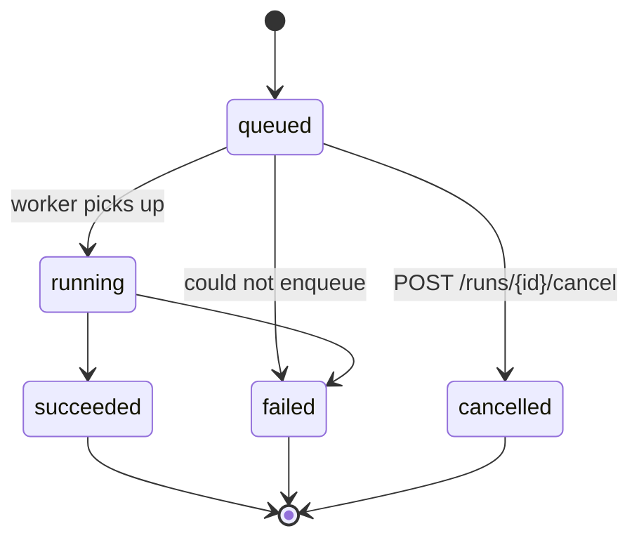
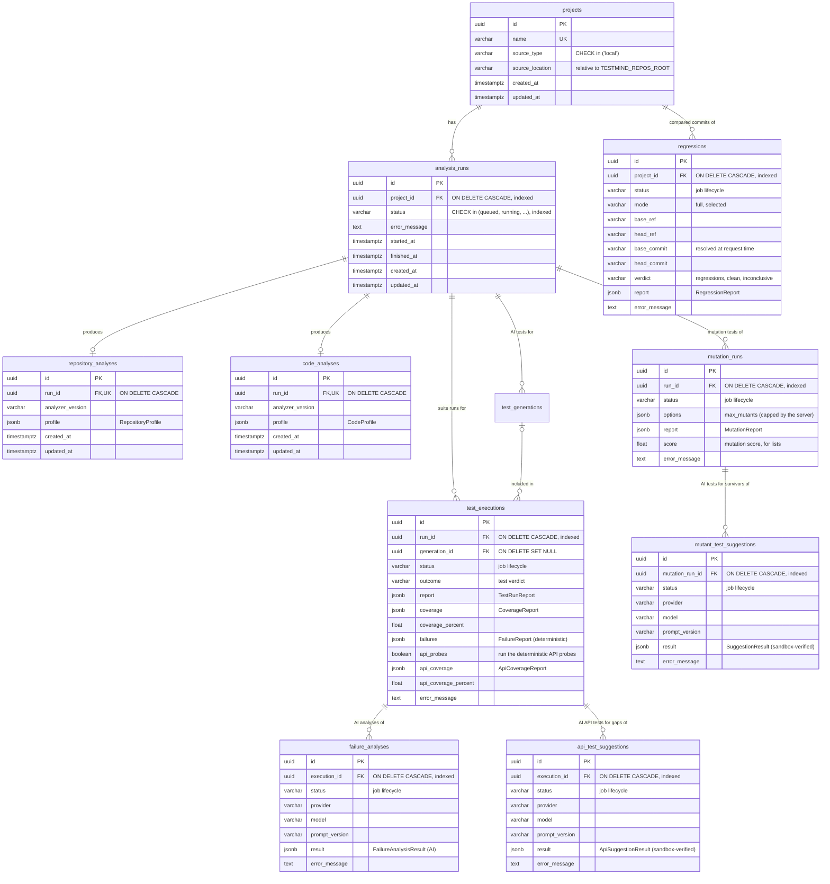

# Architecture

This document describes the architecture **as implemented** (Phase 1) and how later phases fit
into it. Decisions and their trade-offs are recorded in [ADRs](adr/).

## Runtime components

```mermaid
flowchart LR
    browser([Browser]) -->|HTTP :8080| web
    client([API client]) -->|HTTP :8000| api
    subgraph compose[docker compose — network "backend"]
        web[web<br/>nginx: dashboard + API proxy]
        migrate[migrate<br/>alembic upgrade head<br/>one-shot]
        api[api<br/>FastAPI + uvicorn]
        worker[worker<br/>Celery]
        pg[(postgres)]
        redis[(redis)]
    end
    web -->|/api, same origin| api
    migrate --> pg
    api --> pg
    api -->|publish task| redis
    redis -->|consume| worker
    worker --> pg
    repos[/host repos dir<br/>mounted read-only at /repos/] --- api
    repos --- worker
```

| Service | Image target | Role |
|---|---|---|
| `postgres` | `postgres:16-alpine` | System of record: projects, runs (later: results, findings, reports) |
| `redis` | `redis:7-alpine` | Celery broker |
| `migrate` | `api` | Applies Alembic migrations, then exits. `api` and `worker` start only after it succeeds |
| `api` | `api` | HTTP API. Never does heavy work in the request path |
| `web` | `docker/web.Dockerfile` | The dashboard's static files, and a same-origin proxy to the API ([dashboard.md](dashboard.md)) |
| `worker` | `worker` | Executes queued jobs: analysis runs, AI test generations, test executions (later: mutation testing) |

## Code layout

A single Python package, `src/testmind` ([ADR-0002](adr/0002-single-package-src-layout.md)):

```text
src/testmind/
├── core/          config (pydantic-settings), structured logging, domain exceptions
├── domain/        pure logic: enums, run state machine (no I/O, no frameworks)
├── db/            SQLAlchemy base (naming conventions), models, engine/session factories
├── schemas/       Pydantic API contracts (request/response bodies, error model, pagination)
├── repositories/  data access. The only place that builds SQL
├── services/      use cases shared by API and worker (+ the TaskDispatcher port)
├── analyzers/     deterministic analysers: repository/ (repository-analyzer.md), code/ (code-analyzer.md)
├── ai_engine/     LLM interface + providers, versioned prompts, test_generator/ (ai-engine.md)
├── sandbox/       isolated execution of untrusted code (Docker), runner images
├── test_engine/   test-suite runner and structured reports (test-engine.md)
├── github/        GitHub App client, webhooks, pull request analysis and its markdown (github.md)
├── vcs/           read-only git (dulwich), tarball extraction, snapshots (regression.md, github.md)
├── api/           FastAPI app factory, routes, dependencies, error handlers, middleware
└── workers/       Celery app, tasks, Celery-backed TaskDispatcher
```

The dashboard is a separate TypeScript application in `web/` (React, Vite). Its API types
are generated from the backend's OpenAPI schema ([ADR-0013](adr/0013-dashboard-spa-typed-from-openapi.md)).

Later phases add sibling packages when they are implemented. Empty placeholder packages are deliberately
not created ahead of time.

### Dependency rule

```text
api ──► services ──► repositories ──► db
 │         │  └────► domain ◄──────────┘
 │         └── TaskDispatcher (port) ◄── workers.dispatcher (adapter)
 └──► workers.dispatcher (wired in the app factory only)
```

- `domain` imports nothing from the project except `core.errors`.
- `services` never import FastAPI or Celery. They raise domain exceptions (`core/errors.py`),
  which the API maps to HTTP status codes in one place (`api/errors.py`).
- The worker calls the same services as the API, so the business rules exist once.

## Request flow: queueing a run

```mermaid
sequenceDiagram
    participant C as Client
    participant A as API (RunService)
    participant P as PostgreSQL
    participant R as Redis
    participant W as Worker (RunExecutor)
    C->>A: POST /api/v1/projects/{id}/runs
    A->>P: INSERT run (queued) + COMMIT
    A->>R: publish task(run_id)
    A-->>C: 202 {status: queued}
    R->>W: deliver task
    W->>P: SELECT … FOR UPDATE; queued→running; COMMIT
    W->>W: repository analysis → code analysis (no lock held, in a thread)
    W->>P: SELECT … FOR UPDATE; running→succeeded + INSERT both analyses (or →failed); COMMIT
    C->>A: GET /api/v1/runs/{id}
    A-->>C: 200 {status: succeeded}
```

Design points:

- **Commit before publish.** The worker uses its own connection, so the row must be visible
  before the message can arrive. If publishing fails, the run is marked `failed` and the client
  receives `503 dispatch_failed` (unless a concurrent cancel already moved it).
- **Short transactions, row locks.** Every status change takes `SELECT … FOR UPDATE` on the run
  and commits immediately, which serialises cancel-vs-pickup races. The lock is never held while
  work is running.
- **Idempotent execution.** Celery is configured `acks_late` + `reject_on_worker_lost`
  (at-least-once delivery). The executor only picks up a run that is still `queued`, so a
  re-delivered or already-cancelled run is left untouched.
- **Event loops in the worker.** Celery tasks are synchronous. Each task runs
  `asyncio.run(...)` with an unpooled engine because asyncpg connections are bound to the loop
  that created them.

## Run state machine

Defined once in `domain/run_lifecycle.py` and enforced for every change:



`started_at` is set on `running`; `finished_at` is set on every terminal state.

## Data model



- Enumerations are stored as `VARCHAR` + a named `CHECK` constraint instead of native PostgreSQL
  enums, so adding a value is an ordinary transactional migration.
- `source_location` is stored **relative** to the repositories root, so the same row is valid in
  every container regardless of where the root is mounted.
- `repository_analyses.profile` and `code_analyses.profile` are JSONB documents (schemas:
  `RepositoryProfile`, `CodeProfile`). Both are written in the same transaction that marks
  the run `succeeded`, so a succeeded run always has all its analyses and a failed run never
  has a partial one. The code analysis takes the repository analysis's classification of
  test files as input.
- `test_executions.coverage` holds the whole `CoverageReport`; `coverage_percent` duplicates
  its total so lists and comparisons do not have to load the document.
- `test_executions.failures` is the deterministic failure report, written with the execution;
  `failure_analyses` holds the optional AI jobs about it.
- `code_analyses.profile` also holds the statically discovered HTTP endpoints (`api`).
  `test_executions.api_coverage` is the API coverage of the execution (with the probe
  verdicts when `api_probes` was requested); `api_test_suggestions` holds the optional AI
  jobs about it.
- `mutation_runs.report` holds every mutant with its verdict and the scores per file and
  function; `score` duplicates the total for lists. `mutant_test_suggestions` holds the
  optional AI jobs, each suggestion with its sandbox verdicts.
- `github_pull_analyses` holds one row per analysed delivery (`delivery_id` is unique, so
  a re-delivered webhook cannot create a second analysis). It stores the check run and
  comment ids, the created issues and the `PullReport`. `github_imports` records imports.
  `projects.source_type` is `local` or `github`: an imported project's `source_location`
  is `github:<owner>/<repo>/<sha>` under the imports root, and `remote_repository`,
  `remote_ref` and `remote_commit` record where it came from.
- Tables for later phases (reports) are added by the phases that produce that data.
- `tests/integration/test_migrations.py` fails if the ORM models and the migrations drift apart.

## Configuration and logging

- `core/config.py`: a frozen `Settings` object read from `TESTMIND_*` environment variables.
  Connection URLs are `SecretStr`, and the database URL must use the asyncpg driver.
- `core/logging.py`: structlog and the standard library (uvicorn, Celery, SQLAlchemy) share one
  processor chain, so all output is JSON lines in containers. The API middleware binds a
  `request_id` to every log line of a request and returns it as `X-Request-ID`.

## Known limitations (tracked, not hidden)

- **Cancellation** is supported only before a run starts. Running jobs are bounded by the
  Celery time limit and the sandbox timeout.
- **Docker access for the containerised worker** is not configured (see
  [test-engine.md](test-engine.md#running-the-sandbox-from-the-worker)).

Resolved: runs orphaned by a hard worker crash are now failed at worker start-up
([test-engine.md](test-engine.md#orphaned-jobs)).
- **Authentication** is not implemented yet. The API is bound to `127.0.0.1` by default and
  must not be exposed publicly until user management lands.
