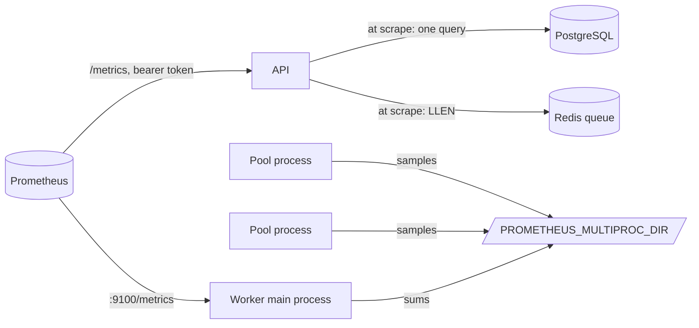

# Monitoring

TestMind exposes Prometheus metrics from the API and the worker. An optional compose overlay
runs Prometheus with alert rules that have their own unit tests. Logs are JSON lines with a
request id ([architecture.md](architecture.md#configuration-and-logging)).

```bash
make up-monitoring    # the stack plus Prometheus on http://127.0.0.1:9090
# with the sandbox as well:
docker compose -f docker-compose.yml -f docker-compose.sandbox.yml \
    -f docker-compose.monitoring.yml up -d --build --wait
```

## Where the metrics come from



- **The API** records every request under its **route template**
  (`/api/v1/runs/{run_id}`), never the raw path, and `unmatched` for unknown paths. The number
  of series stays bounded whatever clients send.
- **The platform's state** is read when Prometheus scrapes:
  - jobs by kind and status, and the age of the oldest queued and running job, in one
    `UNION ALL` query over the ten job tables;
  - the worker queue's length in Redis.

  Any API process gives the same answer. If PostgreSQL or Redis cannot be read,
  `testmind_dependency_up` is 0 and their series are left out; the scrape still succeeds.
- **The worker** runs Celery's prefork pool. Every pool process writes its samples to a file
  in `PROMETHEUS_MULTIPROC_DIR` (a tmpfs in compose). The main process serves the sum on
  `TESTMIND_WORKER_METRICS_PORT` (9100 in compose), and removes an earlier worker's files at
  start. Every worker metric has labels, so a process that only imports the metrics (the
  container's health check) writes nothing.
- `/metrics` is outside `/api/`, but it needs the **API token** when one is set. Compose
  passes `TESTMIND_API_TOKEN` to Prometheus as a secret. The worker's port is reachable only
  on the internal `backend` network.

Design record: [ADR-0015](adr/0015-prometheus-metrics-state-read-at-scrape.md).

## Metrics

| Metric | Type | Labels | Meaning |
|---|---|---|---|
| `testmind_http_requests_total` | counter | `method`, `route`, `status` | Requests answered |
| `testmind_http_request_duration_seconds` | histogram | `method`, `route` | Time to answer |
| `testmind_jobs` | gauge | `kind` (table), `status` | Jobs of each kind and status, zeros included |
| `testmind_oldest_job_age_seconds` | gauge | `status` (`queued`, `running`) | Since creation (queued) or start (running); 0 when none |
| `testmind_queue_messages` | gauge | | Messages waiting in the worker queue, all priorities |
| `testmind_dependency_up` | gauge | `dependency` (`database`, `redis`) | Whether this scrape could read it |
| `testmind_build_info` | gauge | `version` | Always 1 |
| `testmind_tasks_total` | counter | `task`, `outcome` | Worker tasks finished. The outcome is the job's final status (`succeeded`, `failed`, …), `missing` if the job no longer existed, `error` if the task raised |
| `testmind_task_duration_seconds` | histogram | `task` | Time a task ran |
| `testmind_sandbox_runs_total` | counter | `kind` (`pytest`, `mutation`), `result` | Sandbox containers. The result is `timeout`, `exit_<code>` for pytest's 0–5 and Docker's 125–127/137, or `other` |
| `testmind_sandbox_run_duration_seconds` | histogram | `kind` | Time a sandbox container ran |
| `testmind_llm_requests_total` | counter | `outcome` (`ok`, `refused`, `error`) | LLM completions |
| `testmind_llm_request_duration_seconds` | histogram | `outcome` | Time a completion took |
| `testmind_llm_tokens_total` | counter | `direction` (`input`, `output`) | Tokens used: what the provider bills |

Plus the Python process metrics of `prometheus_client` for the API (`process_*`, `python_*`).

A task killed by its hard time limit takes its pool process with it. It is not counted in
`testmind_tasks_total`, but its job shows up as `failed` in `testmind_jobs`.

### Useful queries

```promql
# Requests per second and p95 latency per route, over 5 minutes
sum by (route) (rate(testmind_http_requests_total[5m]))
histogram_quantile(0.95, sum by (le, route) (rate(testmind_http_request_duration_seconds_bucket[5m])))

# Share of test executions that ended failed (the job, not the tests)
sum(rate(testmind_tasks_total{task="testmind.test_execution.execute", outcome="failed"}[1h]))
  / sum(rate(testmind_tasks_total{task="testmind.test_execution.execute"}[1h]))

# Sandbox timeouts per hour; LLM tokens per day (cost)
sum(increase(testmind_sandbox_runs_total{result="timeout"}[1h]))
sum by (direction) (increase(testmind_llm_tokens_total[1d]))
```

## Alerts

The rules are in [`docker/prometheus/alerts.yml`](../docker/prometheus/alerts.yml).
[`alerts.test.yml`](../docker/prometheus/alerts.test.yml) has unit tests for them, including
cases that must *not* fire. `make monitoring-check` runs `promtool check config` and
`promtool test rules`, and CI runs it too.

| Alert | Severity | Fires when |
|---|---|---|
| `TestMindApiDown` | critical | The API cannot be scraped for 2 minutes |
| `TestMindWorkerDown` | critical | The worker cannot be scraped for 2 minutes |
| `TestMindDependencyDown` | critical | The API cannot read PostgreSQL or Redis for 2 minutes |
| `TestMindJobsWaiting` | warning | The oldest queued job is older than 15 minutes, for 5 minutes |
| `TestMindJobStuck` | warning | A job has been running longer than the task time limit plus 5 minutes |
| `TestMindApiErrors` | warning | More than 5 % of requests answer 5xx, for 10 minutes |
| `TestMindApiSlow` | warning | The p95 latency of all requests (except `/metrics`) is above 1 s, for 10 minutes |
| `TestMindTaskErrors` | warning | A worker task raised in the last 15 minutes |
| `TestMindSandboxTimeouts` | info | More than 3 sandbox runs hit their timeout in an hour |
| `TestMindLlmErrors` | warning | More than 20 % of LLM requests fail, for 15 minutes |

Alerts can be seen at <http://127.0.0.1:9090/alerts>. **Routing them to people is not part of
TestMind.** That means Alertmanager with e-mail, chat or a pager, and each deployment has its
own. `TestMindJobStuck` assumes the default task time limit (3600 s); change the threshold
if `TESTMIND_CELERY_TASK_TIME_LIMIT_SECONDS` changes.

## How it is tested

- `tests/api/test_metrics_api.py`: the scrape against the real PostgreSQL and Redis.
  - jobs and ages from real rows, and the queue length with a priority message;
  - unreachable dependencies reported as down, not as a failed scrape;
  - route templates and `unmatched`;
  - the token.
- `tests/unit/test_worker_metrics.py`: task outcomes through Celery's own signals, and
  samples written by several real processes served together by one.
- `tests/unit/ai_engine/test_metering.py`: LLM outcomes and tokens.
- CI's Docker job runs Prometheus with the sandboxed stack. After the smoke test,
  [`scripts/monitoring_check.sh`](../scripts/monitoring_check.sh) checks four things:
  - both targets are scraped, the API with its token;
  - the smoke test's tasks and sandbox runs were recorded;
  - both dependencies are up;
  - no critical alert fires.

## Not included

- **No Grafana dashboards.** Prometheus's own UI and the queries above cover the metrics. A
  dashboard would be one more thing to keep in sync with them.
- **No tracing.** Requests and jobs are correlated by request id and job id in the JSON logs.
- The sandbox proxy has no metrics of its own. Its allow/deny decisions are logged
  (`sandbox_proxy_allowed`, `sandbox_proxy_denied`).
